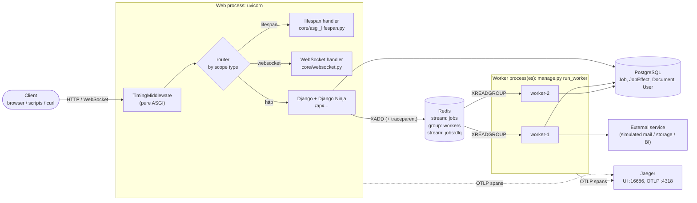
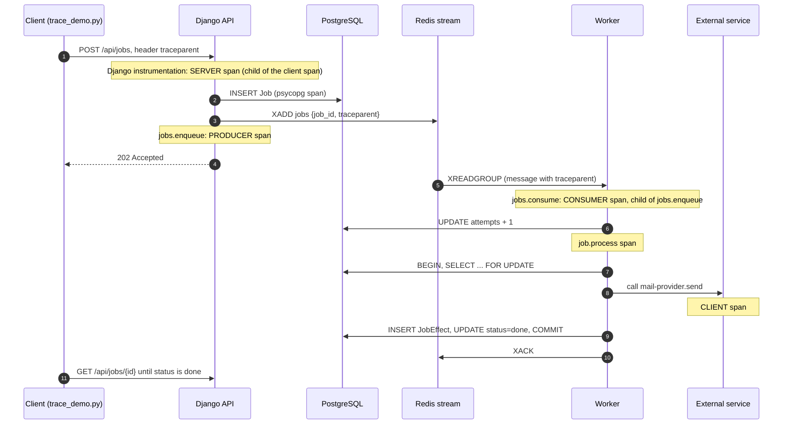
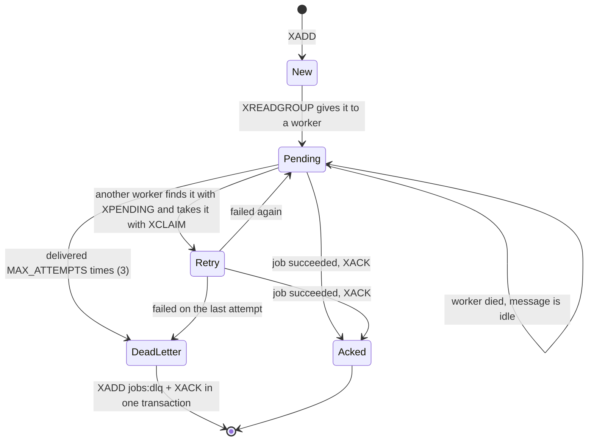
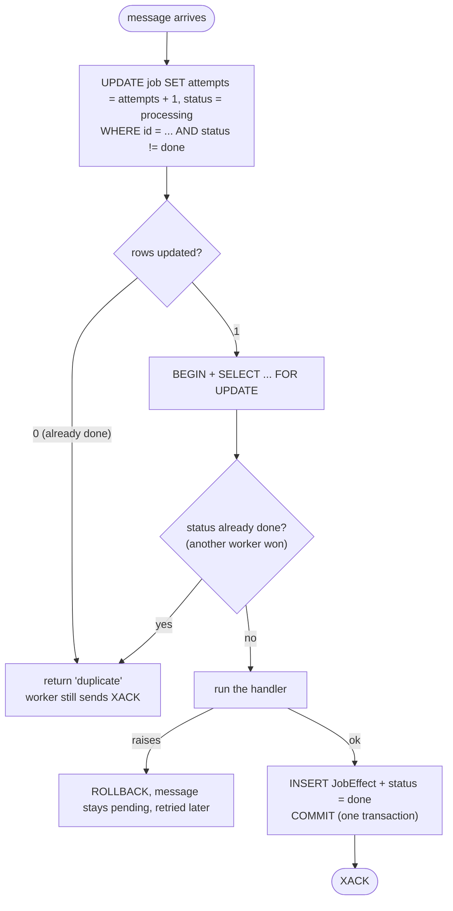

# POC 3: Architecture

Diagrams are written in Mermaid, so GitHub and VS Code (with a Mermaid preview) draw them.

## 1. The big picture



Three separate processes (web, worker 1, worker 2) share only two things: the database and Redis.
The only link between a request and the worker that handles it is a message that holds the job id.

## 2. What an ASGI server sends to the app

An ASGI app is one function: `async def app(scope, receive, send)`.

| `scope["type"]` | Who handles it | Events |
|---|---|---|
| `lifespan` | `core/asgi_lifespan.py` | `lifespan.startup`, `lifespan.shutdown` |
| `websocket` | `core/websocket.py` | `websocket.connect`, `websocket.receive`, `websocket.disconnect` |
| `http` | Django | `http.request`, then `http.response.start` and `http.response.body` |

`TimingMiddleware` wraps the whole app. For HTTP it wraps `send`, so it sees `http.response.start` on the way out and adds the `X-Process-Time-Ms` header.

Sync `def` views are moved by Django to a worker thread. `async def` views run on the event loop. A blocking call inside `async def` blocks the loop (`/api/demo/async-blocking` shows it).

## 3. One trace through the whole system



The trace id travels in three places: the HTTP header `traceparent` (client to API), the Redis message field `traceparent` (API to worker), and the context of the running code (spans inside one process).
Redis commands are not auto-traced on purpose: a worker polling an empty stream would fill Jaeger with useless spans.

Expected span tree in Jaeger:

```
client.send-email-job                       (demo-client)
└─ POST /api/jobs                           (django-api)    SERVER
   ├─ INSERT ... (SQL)                      (django-api)
   └─ jobs.enqueue                          (django-api)    PRODUCER
      └─ jobs.consume                       (worker)        CONSUMER
         └─ job.process
            ├─ UPDATE / SELECT ... FOR UPDATE / INSERT (SQL)
            └─ mail-provider.send                           CLIENT
```

## 4. Life of one message in the stream



Rules the code follows (`jobs/worker.py`):

1. **XACK only after success.** Until then the message stays in the pending list of the group.
2. **Retry = reclaim.** Failed and abandoned messages look the same to Redis (pending and idle), so one mechanism handles both.
3. **Back-off.** A message is retried when it has been idle for `2s * 2^(deliveries - 1)`.
4. **Dead-letter after 3 deliveries.** The message is copied to `jobs:dlq` and acknowledged in one `MULTI/EXEC`, so it is never in both places or in neither.
5. **Heartbeat.** Long jobs call `XCLAIM ... JUSTID` on their own message to reset its idle time without raising the delivery counter, so other workers do not steal it.

## 5. Why a job cannot run twice (idempotency)

`jobs/service.py: process_job`:



- `JobEffect` has a `OneToOneField` to `Job`. Even if the code had a bug, the database refuses a second effect.
- The attempt counter is a separate auto-committed statement, so it survives a rollback.
- Crash after the commit but before `XACK`: the message is redelivered and found `done`, so it is skipped.

## 6. Failure scenarios and who handles them

| Scenario | What happens | Handled by |
|---|---|---|
| Handler raises | no XACK, status `retrying`, retried after back-off | `Worker.handle` / `on_failure` |
| Worker killed mid-job (`os._exit`) | transaction rolled back by the database, message stays pending, another worker claims it | `Worker.recover_pending` |
| Worker dies right after reading | same as above | `Worker.recover_pending` |
| Job fails every time | after 3 deliveries it is moved to `jobs:dlq`, status `dead` | `Worker.dead_letter` |
| Same message delivered twice | second run returns `duplicate`, one `JobEffect` | `process_job` |
| Commit done, XACK lost | redelivery is a no-op | `process_job` |
| Two workers claim the same message | `XCLAIM` re-checks idle time atomically, one wins; `SELECT FOR UPDATE` covers the rest | Redis + Postgres |
| Redis down when creating a job | API answers `503`, the job row is marked `dead` | `jobs/api.py` |
| Garbage message (bad `job_id`) | fails 3 times, lands in the DLQ, the worker keeps running | `Worker.handle` |
| Unhandled error in the API | client gets a generic message and an `error_id`, details go to the log and the span | `config/api.py` |

## 7. Data model

```mermaid
erDiagram
    USER ||--o{ DOCUMENT : owns
    JOB ||--o| JOBEFFECT : "produces at most one"

    USER {
        int id PK
        string username
        string password "hashed"
        bool is_staff
    }
    DOCUMENT {
        int id PK
        int owner_id FK
        string title
        text content
    }
    JOB {
        uuid id PK
        string kind "email, file, report, long"
        json payload
        string status "queued, processing, retrying, done, dead"
        int attempts
        text last_error
        string processed_by
    }
    JOBEFFECT {
        int id PK
        uuid job_id FK "unique"
        string description
    }
```



## 8. Project map

```
POC-3-Raw/
├── config/        settings, ASGI entry point (router + middleware), URLs, the NinjaAPI
├── core/          telemetry, ASGI middleware / lifespan / WebSocket, security log, demo endpoints
├── accounts/      JWT auth, register / login, lock-out after failed attempts
├── documents/     IDOR demo: secure and vulnerable routers over the same model
├── jobs/          models, Redis stream producer + worker, handlers, API, manage.py commands
├── owasp/         vulnerable / secure demo endpoints, configuration audit
├── scripts/       demo clients (sync vs async, WebSocket, trace, IDOR, OWASP)
├── tests/         pytest suite (no Redis / Jaeger needed)
└── asgi-demo/     small stand-alone ASGI / WSGI examples
```
