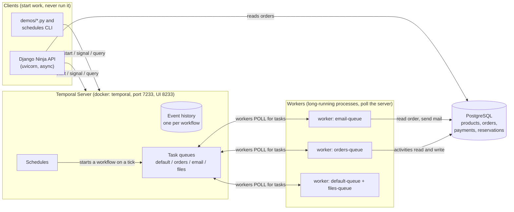
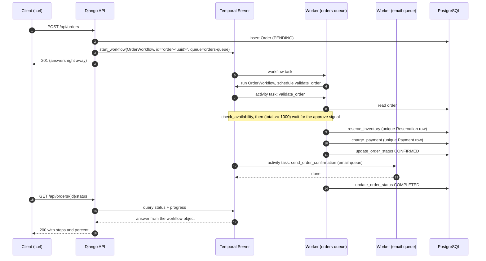
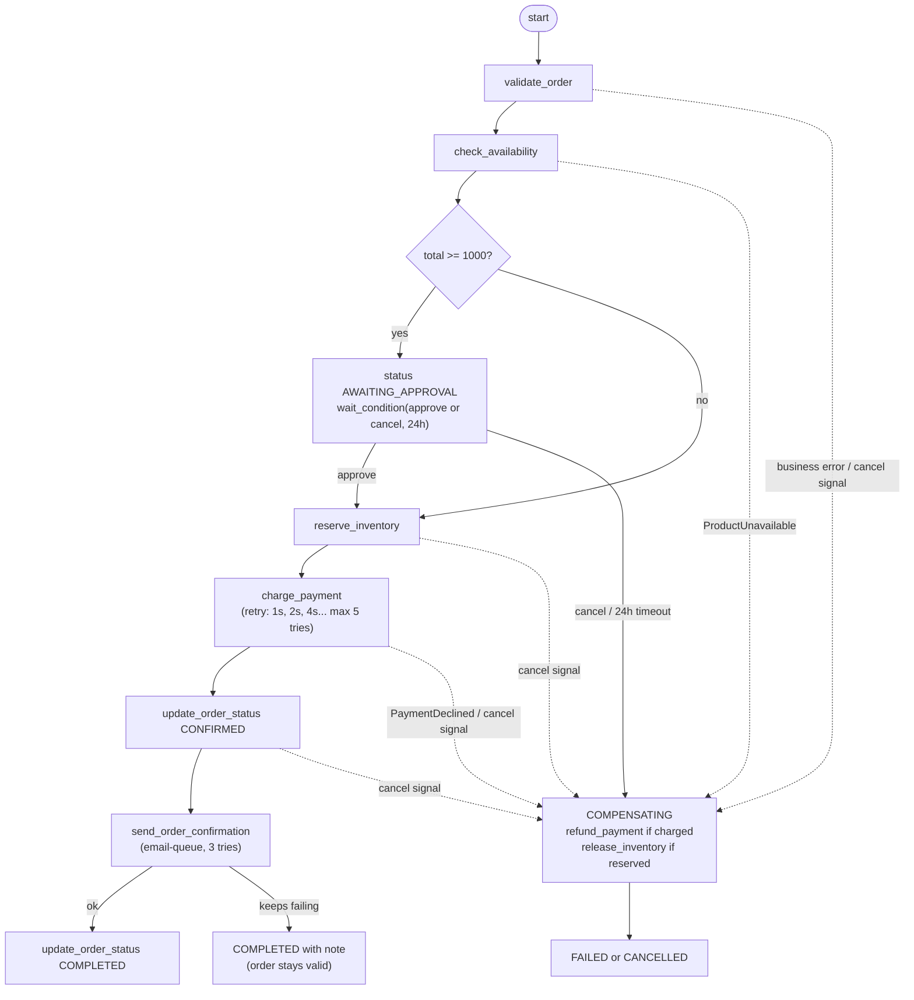
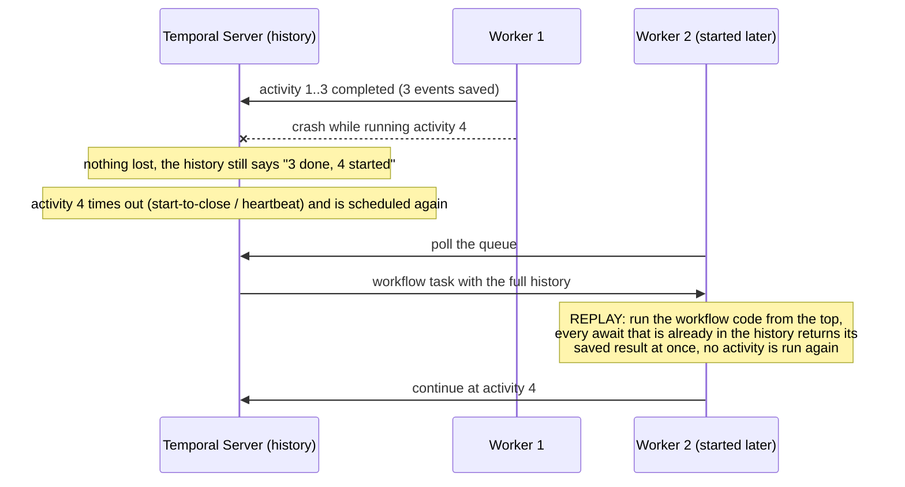
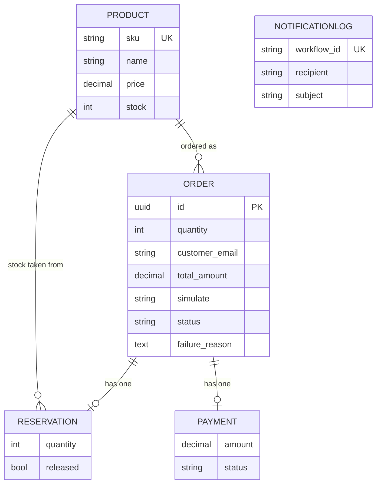
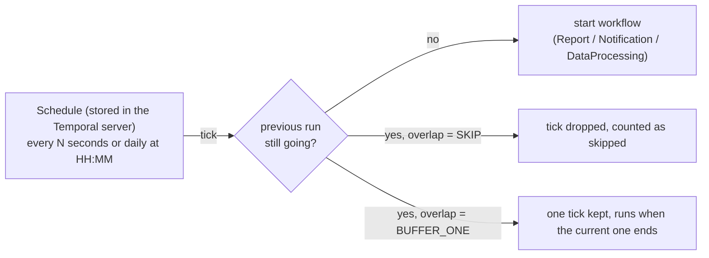

# Architecture

Diagrams are Mermaid, so GitHub and VS Code render them.

## 1. The four parts



- The **client** only talks to the server (gRPC, port 7233). It does not know where a worker is.
- The **server** stores the event history and the task queues. It runs no application code.
- A **worker** polls a task queue, runs workflow code or an activity, and reports the result. It keeps nothing between tasks, so any number of workers can be started, stopped or crashed.
- **Activities** are the only place that touches PostgreSQL, the (fake) payment gateway and email.

## 2. One order, start to finish



Every arrow between a worker and the server becomes an **event in the history** (`WorkflowTaskScheduled`, `ActivityTaskScheduled`, `ActivityTaskCompleted`, ...). That list is the state of the workflow.

## 3. The order workflow as a flow (saga)



- Solid arrows are the happy path. Dotted arrows are failures; the workflow undoes what it did, newest first.
- A **retryable** error (gateway down, timeout) never reaches the dotted path until the retry policy gives up.
- The `cancel` signal is checked after each step (`_check_cancel`) and while waiting for approval.

## 4. What happens when a worker dies



That is why workflow code must be **deterministic**: the replay must reach the same decisions as the first run, otherwise it cannot line up with the history.

## 5. Task queues and who listens

| Task queue | Workflows registered | Activities registered | Started with |
|---|---|---|---|
| `default-queue` | Hello, Notification, RetryDemo, LongRunning, Report, DataProcessing | demo activities, `record_notification`, `generate_report`, `list_inbox_files` | `--queue default` |
| `orders-queue` | OrderWorkflow | validate, availability, reserve, charge, update status, release, refund | `--queue orders` |
| `email-queue` | none (activity-only worker) | `send_email`, `send_order_confirmation` | `--queue email` |
| `files-queue` | ProcessFileWorkflow (child) | `process_file`, `archive_file` | `--queue files` |

`--queue all` (the default) starts one worker per queue inside a single process. A workflow asks for an activity on a queue (`task_queue=EMAIL_TASK_QUEUE`), and only a worker that listens there and has registered that activity will pick it up. If nobody listens, the task waits (`demos.notification` shows this) or hits a `schedule_to_start` timeout (`demos.retries schedule_to_start`).

## 6. Database



- `RESERVATION.order` and `PAYMENT.order` are one-to-one. That unique constraint is what makes the activities **idempotent**: a retry finds the existing row and does not take stock or money twice.
- `NOTIFICATIONLOG.workflow_id` is unique for the same reason.
- Order status values: `PENDING`, `AWAITING_APPROVAL`, `CONFIRMED`, `COMPLETED`, `FAILED`, `CANCELLED`.
- The Temporal server keeps its own history (`start-dev` stores it in a SQLite file on a Docker volume). That is separate from the Django PostgreSQL database.

## 7. Schedules (replacement for Celery Beat)



Created, paused, resumed, triggered and deleted with `python -m temporal_app.schedules ...`. Because a tick starts an ordinary workflow, scheduled runs get retries and history like any other.

## 8. Project map

```
POC-4/
├── config/                  Django settings (env based), urls, asgi
├── orders/                  Django app: models, services (DB logic), api (Ninja), seed_products command
├── temporal_app/
│   ├── constants.py         task queue names, timeouts (no Django imports, used inside workflows)
│   ├── policies.py          retry policies
│   ├── payloads.py          dataclasses passed between client, workflows and activities
│   ├── client.py            one cached Temporal client per process
│   ├── bootstrap.py         django.setup() for workers and CLIs
│   ├── schedules.py         schedules CLI (create / list / describe / pause / ...)
│   ├── workflows/           order.py (saga), demo.py (hello, retries, long running, report), files.py (parent + child)
│   ├── activities/          orders.py, demo.py, notifications.py, files.py, reports.py
│   └── workers/             registry.py (queue -> workflows + activities), run_worker.py
├── demos/                   runnable scenarios for each topic of the assignment
├── tests/                   activity, workflow (time-skipping server), service, API and worker tests
└── docker-compose.yml       PostgreSQL 17 + Temporal dev server with Web UI
```

Layering rule: **workflows decide, activities do, services hold the database logic**. A workflow never touches the database. An activity is a thin wrapper around a function in `orders/services.py`, so the same logic is tested without Temporal.
